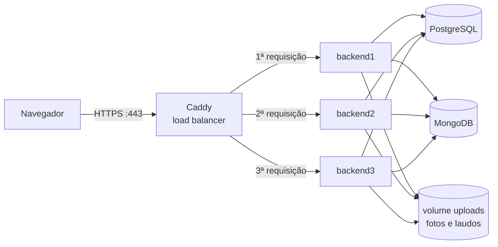

# Load balancer

O backend roda em **3 cópias iguais** (`backend1`, `backend2` e `backend3`) na mesma instância. O **Caddy** fica na frente e reparte as requisições da API entre elas. Se uma cópia cair, as outras continuam atendendo e o site não sai do ar.

## Sumário

1. [Como fica](#1-como-fica)
2. [Arquivos](#2-arquivos)
3. [Como o Caddy reparte as requisições](#3-como-o-caddy-reparte-as-requisições)
4. [Por que dá para ter 3 cópias](#4-por-que-dá-para-ter-3-cópias)
5. [Como demonstrar](#5-como-demonstrar)
6. [Problemas comuns](#6-problemas-comuns)

---

## 1. Como fica



Só o `/api` (e o `/docs`) passa pelo balanceamento. O site React é servido pelo próprio Caddy.

## 2. Arquivos

| Arquivo | O que mudou |
|---|---|
| `docker-compose.prod.yml` | O serviço `backend` virou `backend1`, `backend2` e `backend3`. A configuração comum fica num bloco só (`x-backend`) e cada cópia reaproveita com `<<: *backend` |
| `deploy/Caddyfile` | `reverse_proxy` com as 3 cópias, rodízio e health check |
| `backend/app/main.py` | Rota `GET /api/health` e o cabeçalho `X-Backend-Instance` em toda resposta |
| `backend/app/config.py` | `INSTANCE_NAME`: o nome da cópia (vem da variável de ambiente) |
| `backend/tests/test_health.py` | Testes da rota de saúde e do cabeçalho |

## 3. Como o Caddy reparte as requisições

```
reverse_proxy backend1:8000 backend2:8000 backend3:8000 {
    lb_policy round_robin
    health_uri /api/health
    health_interval 10s
    health_timeout 3s
    fail_duration 30s
    lb_try_duration 5s
}
```

**Rodízio (`round_robin`):** a 1ª requisição vai para uma cópia, a 2ª para a próxima, a 3ª para a seguinte, e recomeça. Todas recebem a mesma quantidade de trabalho.

**Health check ativo (`health_uri`):** a cada 10 segundos o Caddy chama `/api/health` em cada cópia. A que não responder em 3 segundos sai do rodízio até voltar a responder.

**Health check passivo (`fail_duration`):** se uma cópia falhar numa requisição de verdade, o Caddy tira ela do rodízio por 30 segundos e tenta a mesma requisição em outra cópia (por até 5 segundos, `lb_try_duration`). Quem está usando o site não vê o erro.

**`/api/health`:** rota sem login que só responde `{"status": "ok", "instance": "backend2"}`. Se a cópia travou ou caiu, ela não responde, e é isso que o Caddy percebe.

**`X-Backend-Instance`:** cabeçalho que o backend coloca em toda resposta dizendo qual cópia atendeu. Serve para ver o balanceamento acontecendo (no terminal com `curl -I` ou no navegador, em **F12 → Rede**).

## 4. Por que dá para ter 3 cópias

Uma requisição pode cair numa cópia e a seguinte, em outra. Isso só funciona porque **nenhuma cópia guarda nada só para ela** (o backend é *stateless*):

| O que precisa ser igual em todas | Como ficou |
|---|---|
| Login | O token JWT vai no cookie e é assinado com a mesma `SECRET_KEY` nas 3 cópias. Qualquer uma confere a assinatura; não existe "sessão guardada na memória" |
| Dados | Todas usam o mesmo PostgreSQL e o mesmo MongoDB |
| Fotos e laudos | As 3 montam o mesmo volume `uploads`. Uma foto enviada para a backend1 abre pela backend3 |
| Criação das tabelas | A `backend1` sobe primeiro e cria as tabelas. A `backend2` e a `backend3` esperam ela ficar `healthy` (`depends_on`), para não tentarem criar as mesmas tabelas ao mesmo tempo |

**Memória:** cada cópia usa por volta de 80 a 100 MB. Na t3.micro (1 GB + 2 GB de swap) as 3 cabem junto com os bancos; não vale a pena passar disso nessa instância.

## 5. Como demonstrar

Na instância, dentro de `~/OncoPet` (com o atalho `dc`; sem ele, troque `dc` por `docker compose -f docker-compose.prod.yml --env-file .env.prod`).

**Ver as 3 cópias rodando:**
```bash
dc ps
```

**Ver o rodízio** (6 requisições seguidas, cada uma numa cópia):
```bash
for i in 1 2 3 4 5 6; do curl -s https://SEU-ENDERECO.sslip.io/api/health; echo; done
```
```
{"status":"ok","instance":"backend1"}
{"status":"ok","instance":"backend2"}
{"status":"ok","instance":"backend3"}
{"status":"ok","instance":"backend1"}
...
```

**Derrubar uma cópia e ver o site continuar no ar:**
```bash
dc stop backend2
```
Rode o `for` de novo: só aparecem `backend1` e `backend3`, sem nenhum erro. O site continua funcionando normalmente.

**Ligar de novo:**
```bash
dc start backend2
```
Em até uns 30 segundos ela volta ao rodízio sozinha.

**Ver o balanceamento no navegador:** F12 → aba **Rede** → clique numa requisição `/api/...` → em **Cabeçalhos de resposta** aparece `X-Backend-Instance`. Recarregando a página, o valor muda.

**Ver os logs das 3 cópias juntos:**
```bash
dc logs -f backend1 backend2 backend3
```

## 6. Problemas comuns

| Sintoma | Causa provável | Solução |
|---|---|---|
| Depois de atualizar, sobra um contêiner `oncopet-backend-1` antigo | O serviço `backend` não existe mais | `dc up -d --build --remove-orphans` |
| Depois de atualizar, a API dá `502` e o `/api/health` sempre responde a mesma cópia (ou nenhuma) | O Caddy ainda está com o Caddyfile antigo, que mandava tudo para `backend` | `dc restart web` |
| `backend2` e `backend3` ficam em `Created` e não sobem | A `backend1` ainda não ficou `healthy` | `dc logs backend1`; normalmente é o banco ainda iniciando |
| Uma cópia sumiu do rodízio | Ela caiu ou travou | `dc ps` para ver qual; `dc logs backend2`; `dc restart backend2` |
| `502` em todas as requisições da API | As 3 cópias estão fora | `dc logs backend1`; confira se postgres e mongodb estão `healthy` |
| Instância lenta ou travando | Pouca memória | `free -h` e `docker stats --no-stream`; o swap tem que aparecer |
