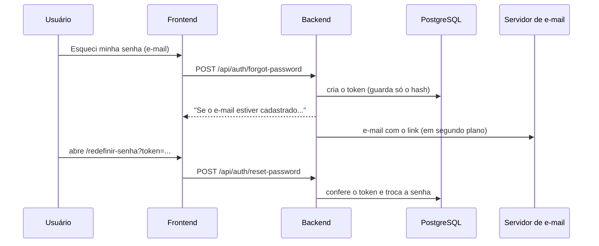

# Recuperação de senha

Quando o veterinário ou o tutor esquece a senha, ele pede um link na tela de login e cria uma senha nova pelo e-mail do cadastro.

## Sumário

1. [Como funciona para quem usa](#1-como-funciona-para-quem-usa)
2. [Como funciona por dentro](#2-como-funciona-por-dentro)
3. [Segurança](#3-segurança)
4. [Configurar o envio de e-mail](#4-configurar-o-envio-de-e-mail)
5. [Testar sem servidor de e-mail](#5-testar-sem-servidor-de-e-mail)
6. [Arquivos](#6-arquivos)
7. [Problemas comuns](#7-problemas-comuns)

---

## 1. Como funciona para quem usa

1. Na tela de login, clica em **Esqueci minha senha**.
2. Digita o **e-mail do cadastro** e clica em **Enviar link**.
3. Recebe o e-mail **"OncoPet: crie uma nova senha"**, com o botão **Criar nova senha**.
4. O botão abre a página **Nova senha**: digita a senha nova duas vezes e salva.
5. Volta para o login e entra com a senha nova.

O link vale **30 minutos** e só pode ser usado **uma vez**.

Por isso o **e-mail passou a ser obrigatório no cadastro**. Contas antigas sem e-mail não conseguem recuperar a senha por aqui.

## 2. Como funciona por dentro



| Rota | Recebe | Faz |
|---|---|---|
| `POST /api/auth/forgot-password` | `{"email": "..."}` | Cria um token para cada conta com esse e-mail e manda o link. Responde **sempre a mesma mensagem** |
| `POST /api/auth/reset-password` | `{"token": "...", "new_password": "..."}` | Confere o token e troca a senha. Token inválido, vencido ou já usado: **400** |

Os tokens ficam na tabela **`password_reset_tokens`** do PostgreSQL. Ela é criada sozinha quando o backend sobe (`create_all`), sem migração.

| Coluna | O que guarda |
|---|---|
| `user_id` | de quem é o pedido |
| `token_hash` | o **hash SHA-256** do token (o token em si só vai no e-mail) |
| `expires_at` | quando vence (30 minutos depois do pedido) |
| `used_at` | quando foi usado; vazio = ainda vale |

A regra fica em `backend/app/services/password_reset.py`:
- **`create_reset_tokens`**: gera o token com `secrets.token_urlsafe(32)` e grava o hash.
- **`reset_password`**: confere hash, validade e uso; troca a senha com `hash_password` (bcrypt) e invalida todos os links pendentes daquela conta.

O e-mail é montado e enviado por `backend/app/emails.py`, com texto puro e HTML.

## 3. Segurança

| Cuidado | Por quê |
|---|---|
| Resposta sempre igual, com ou sem conta | A rota não serve para descobrir quem está cadastrado |
| Só o hash do token no banco | Quem ler a tabela não consegue usar os links já enviados |
| Link vence em 30 minutos e vale uma vez | Um e-mail antigo esquecido na caixa de entrada não vira porta de entrada |
| Trocar a senha invalida os outros links da conta | Pedidos repetidos não deixam links soltos |
| Um e-mail por conta a cada 60 segundos | Ninguém consegue encher a caixa de entrada de outra pessoa |
| O endereço do link vem do `APP_URL` (configuração), nunca do pedido | Impede forjar um link que aponte para outro site |
| Senha nova com no mínimo 6 caracteres | Validado no backend (422) e na tela |

## 4. Configurar o envio de e-mail

O backend envia por **SMTP**. As variáveis ficam no `.env.prod` (produção) ou no `.env` (desenvolvimento):

| Variável | Exemplo | Para quê |
|---|---|---|
| `SMTP_HOST` | `smtp.gmail.com` | servidor de e-mail. **Vazio = não envia** (seção 5) |
| `SMTP_PORT` | `587` | 587 (STARTTLS) ou 465 (SSL) |
| `SMTP_USER` | `seu.email@gmail.com` | usuário do servidor |
| `SMTP_PASSWORD` | senha de app | senha do servidor |
| `SMTP_FROM` | `OncoPet <seu.email@gmail.com>` | remetente que aparece no e-mail |
| `APP_URL` | `https://3-228-54-7.sslip.io` | começo do link. Sem ele, o compose usa `https://` + `DOMAIN` |

### Com Gmail

1. Na conta Google, ative a **verificação em duas etapas**.
2. Crie uma **senha de app** em **Conta Google → Segurança → Senhas de app**. São 16 letras.
3. No `.env.prod` da instância:
   ```
   SMTP_HOST=smtp.gmail.com
   SMTP_PORT=587
   SMTP_USER=seu.email@gmail.com
   SMTP_PASSWORD=as16letrasdasenhadeapp
   SMTP_FROM=OncoPet <seu.email@gmail.com>
   ```
4. Aplique: `dc up -d` (recria os backends com as variáveis novas).

Use a **senha de app**, nunca a senha da conta. O `.env.prod` não vai para o GitHub.

### Site acessado pela VPN

Se o site é aberto por `http://10.8.0.1`, o link do e-mail precisa apontar para lá, e o cookie precisa funcionar sem HTTPS:
```
APP_URL=http://10.8.0.1
COOKIE_SECURE=false
```

## 5. Testar sem servidor de e-mail

Com `SMTP_HOST` vazio, o e-mail **não sai**: o backend escreve o conteúdo, com o link, no log.

```bash
dc logs --tail 30 backend1 backend2 backend3
```
Procure a linha `[e-mail nao enviado: SMTP nao configurado]`. O link `.../redefinir-senha?token=...` vem logo abaixo; é só abrir no navegador.

Com SMTP configurado, o log mostra `[e-mail] enviado para ...` ou `[e-mail] falha ao enviar para ...`.

## 6. Arquivos

| Arquivo | O que mudou |
|---|---|
| `backend/app/routers/auth.py` | rotas `forgot-password` e `reset-password` |
| `backend/app/services/password_reset.py` | criar e conferir os tokens |
| `backend/app/emails.py` | envio por SMTP e o texto do e-mail |
| `backend/app/models.py` | tabela `password_reset_tokens` |
| `backend/app/schemas.py` | e-mail obrigatório no cadastro; schemas das duas rotas |
| `backend/app/config.py` | `APP_URL`, `SMTP_*`, validade do link |
| `backend/tests/test_password_reset.py` | 14 testes (fluxo, link vencido, reuso, e-mail desconhecido...) |
| `frontend/src/components/ForgotPassword.jsx` | tela "Esqueci minha senha" |
| `frontend/src/pages/ResetPassword.jsx` | página do link (`/redefinir-senha`) |
| `frontend/src/pages/Login.jsx` | link "Esqueci minha senha" e e-mail obrigatório |
| `docker-compose.prod.yml`, `.env.prod.example`, `deploy/gerar-env.sh` | variáveis de e-mail |

## 7. Problemas comuns

| Sintoma | Causa provável | Solução |
|---|---|---|
| O e-mail não chega e o log diz "SMTP nao configurado" | `SMTP_HOST` vazio | Preencha as variáveis (seção 4) e rode `dc up -d` |
| Log diz "falha ao enviar" | Usuário/senha errados, ou senha da conta no lugar da senha de app | Gere uma senha de app no Gmail |
| O e-mail chegou, mas o link abre outro endereço | `APP_URL` errado | Ajuste o `APP_URL` no `.env.prod` e rode `dc up -d` |
| "Link inválido ou vencido" | Passou de 30 minutos, ou o link já foi usado | Peça um novo em "Esqueci minha senha" |
| Pediu de novo e não chegou outro e-mail | Menos de 60 segundos desde o pedido anterior | Espere um minuto e peça de novo |
| O e-mail foi para o spam | Remetente novo | Marque como "não é spam" |
